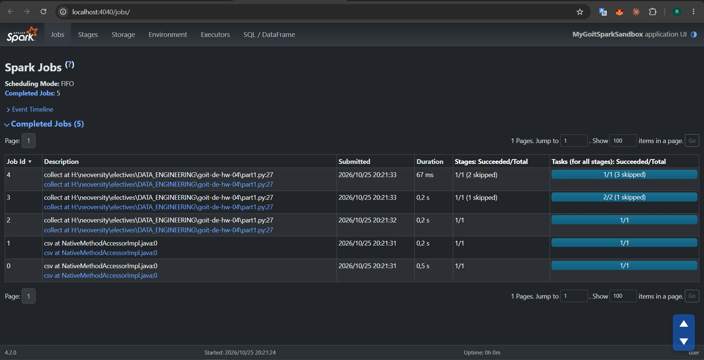
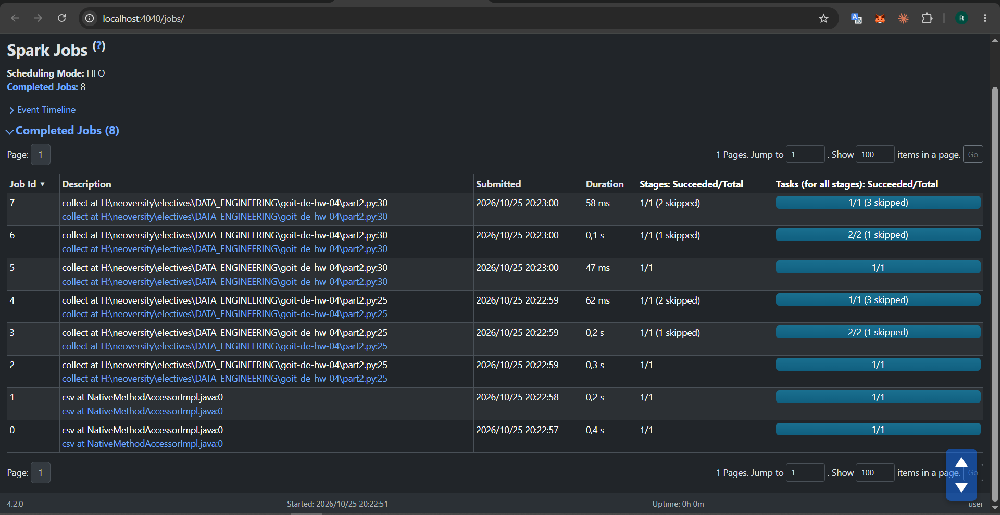
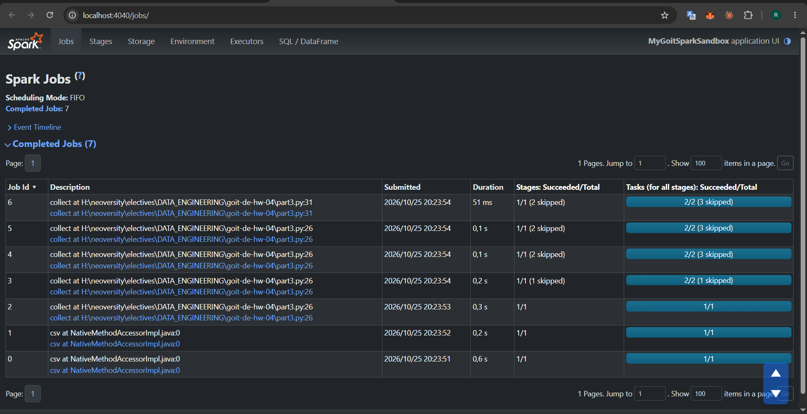

# goit-de-hw-04

Apache Spark. Оптимізація та Spark UI.

Код запускався локально (Windows, Python 3.12, Java 17, PySpark 4.2.0) на датасеті `nuek-vuh3.csv`. Скриншоти зроблено зі сторінки Spark UI `http://localhost:4040/jobs/`, поки програма чекала на `input()`.

Файли:

- `part1.py`, `part2.py`, `part3.py` — код трьох частин;
- `p1_jobs.PNG`, `p2_jobs.PNG`, `p3_jobs.PNG` — скриншоти Jobs;
- `nuek-vuh3.csv` — вхідні дані.

## Частина 1 — 5 Jobs

- **Job 0, 1 (`csv`)** — читання CSV: Spark читає перший рядок, щоб отримати заголовок, а потім проходить файл ще раз через `inferSchema`, щоб визначити типи колонок.
- **Job 2, 3, 4 (`collect`, рядок 27)** — один `collect()`. Запит містить два shuffle: `repartition(2)` і `groupBy("unit_id")`. Adaptive Query Execution розбиває план на етапи по межах shuffle і запускає кожен як окремий Job:
  - Job 2 — читання даних і shuffle для `repartition(2)`;
  - Job 3 — `where` + `select` + часткова агрегація і shuffle для `groupBy`;
  - Job 4 — фінальна агрегація `count()`, фільтр `count>2` і повернення результату драйверу.

Трансформації (`where`, `select`, `groupBy`, `count`, ще один `where`) ліниві: вони лише будують план, а виконується він тільки на action `collect()`.

## Частина 2 — 8 Jobs

- **Job 0, 1** — так само читання CSV і `inferSchema`.
- **Job 2, 3, 4 (рядок 25)** — проміжний `collect()` для `nuek_processed` (без `where("count>2")`): ті самі три етапи, що й у частині 1.
- **Job 5, 6, 7 (рядок 30)** — фінальний `collect()` після `where("count>2")`.

**Чому одна проміжна дія додала аж 3 Jobs?** DataFrame у Spark не зберігає результати обчислень — це лише план. Кожен action виконує план з самого початку. Тому другий `collect()` знову читає дані, знову робить `repartition`, знову `groupBy` і `count`, тобто повторює всі три етапи. Це видно і на скриншоті: Job 5 має `1/1` без skipped-етапів, тобто дані читаються заново.

## Частина 3 — 7 Jobs

- **Job 0, 1** — читання CSV і `inferSchema`.
- **Job 2, 3, 4, 5 (рядок 26)** — перший `collect()` для `nuek_processed_cached`. Тут виконуються ті самі етапи (`repartition`, `groupBy`, `count`), а результат `count()` одночасно зберігається в пам'яті через `cache()`. Заповнення кешу — це ще один окремий Job, тому тут їх 4, а не 3.
- **Job 6 (рядок 31)** — фінальний `collect()` після `where("count>2")`. Він бере вже готовий результат з кешу і лише застосовує фільтр, тому це **один** Job, а всі попередні етапи позначено як skipped (`3 skipped`).

**Чому `cache()` зменшив кількість Jobs?** Без кешу (частина 2) другий action повторює весь ланцюжок обчислень — 3 Jobs. З кешем результат `groupBy().count()` після першого action лежить у пам'яті, і другий action читає його звідти, а не перераховує — 1 Job. У сумі виходить 7 замість 8, і чим більше дій над тим самим DataFrame, тим більша економія.

## Що робить `cache()` і навіщо він потрібен

- `cache()` позначає DataFrame для збереження в пам'яті (для DataFrame рівень за замовчуванням — `MEMORY_AND_DISK`; `persist()` дозволяє вибрати інший рівень).
- Кешування ліниве: дані потрапляють у кеш лише під час першого action.
- Наступні actions і трансформації над цим DataFrame беруть дані з кешу, а не обчислюють їх знову з джерела.
- Це варто робити, коли один і той самий проміжний результат використовується кілька разів, особливо якщо до нього веде дорогий ланцюжок (читання, shuffle, агрегації).
- Коли кеш більше не потрібен, його звільняють через `unpersist()`, як у кінці `part3.py`.
